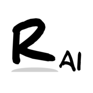
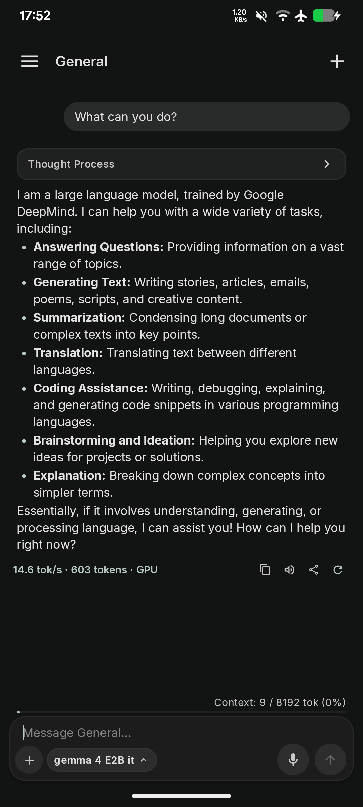
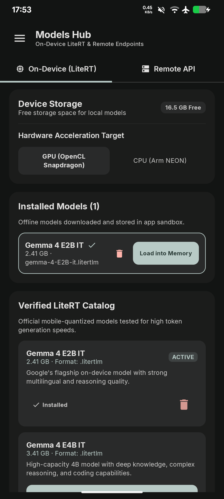
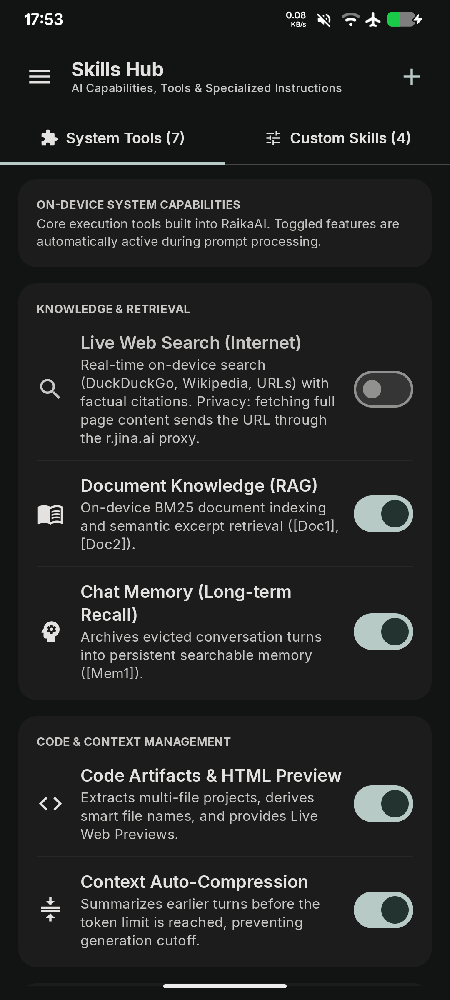
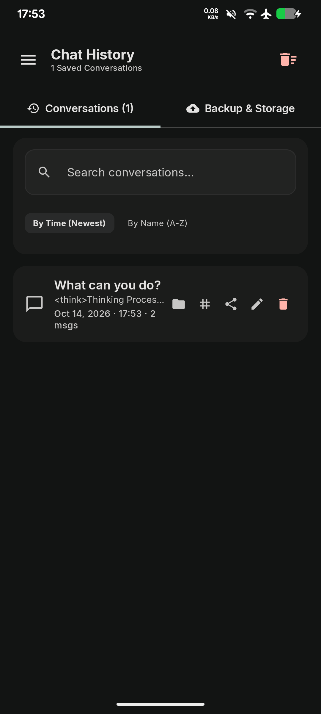

<div align="center">
  
  <h1>RaikaAI</h1>

  <p>
    <a href="LICENSE"></a>
    <a href="https://github.com/kouzen-neo/raikaai/releases"></a>
    <a href="https://developer.android.com"></a>
    <a href="https://ai.google.dev/edge/litert"></a>
    <a href="https://ktor.io/"></a>
  </p>

  <p>
    <a href="README.md"></a>
    <a href="README.id.md"></a>
  </p>
</div>

RaikaAI adalah aplikasi chat AI open-source mandiri (*100% on-device*) dan server inferensi lokal untuk Android yang ditenagai oleh **Google AI Edge LiteRT-LM** (`com.google.ai.edge.litertlm`). Aplikasi ini menjalankan model bahasa besar (LLM seperti Gemma 4, SmolLM2, Llama 3.2, dan Qwen) langsung di hardware smartphone dengan akselerasi GPU Qualcomm Adreno / ARM Mali (OpenCL) serta fallback CPU.

Selain antarmuka obrolan, RaikaAI menyematkan **server HTTP kompatibel OpenAI (`/v1`)** berbasis **Ktor CIO**, memungkinkan smartphone Android Anda berfungsi sebagai backend mesin inferensi LLM lokal untuk aplikasi desktop, IDE (seperti VS Code Continue), OpenWebUI, dan SillyTavern melalui jaringan Wi-Fi/LAN.

<div align="center">
  <table>
    <tr>
      <td align="center" width="20%"><b>Layar&nbsp;Obrolan</b></td>
      <td align="center" width="20%"><b>Hub&nbsp;Model</b></td>
      <td align="center" width="20%"><b>Karakter</b></td>
      <td align="center" width="20%"><b>Skills&nbsp;&amp;&nbsp;Tools</b></td>
      <td align="center" width="20%"><b>Riwayat&nbsp;Chat</b></td>
    </tr>
    <tr>
      <td align="center" valign="top"></td>
      <td align="center" valign="top"></td>
      <td align="center" valign="top"></td>
      <td align="center" valign="top"></td>
      <td align="center" valign="top"></td>
    </tr>
  </table>
</div>

---

## Fitur & Keunggulan Utama

- **100% Offline AI di Perangkat (Google LiteRT-LM)**: Jalankan inferensi LLM secara lokal tanpa koneksi internet dan tanpa biaya langganan, menggunakan akselerasi native GPU OpenCL (Adreno / Mali) dan fallback CPU (Arm NEON / XNNPack).
- **Embedded OpenAI-Compatible Server**: Server Ktor CIO berkecepatan tinggi yang mengekspos endpoint `/v1/chat/completions` (streaming SSE + JSON), `/v1/completions`, dan `/v1/models`. Hubungkan VS Code Continue, OpenWebUI, atau SillyTavern ke smartphone Anda melalui Wi-Fi.
- **Karakter & Custom Persona (v2)**: Buat dan ganti persona AI dengan foto avatar profil, pesan sambutan, skenario, instruksi sistem khusus, dan contoh dialog. Dukungan penuh ekspor/impor file JSON standar.
- **RAG & Chat Dokumen On-Device**: Impor file PDF, TXT, MD, CSV, dan source code ke dalam basis pengetahuan lokal. AI mengutip dan mereferensikan kutipan langsung di perangkat (`[Doc1]`, `[Doc2]`).
- **Keterampilan Modular & Klien MCP**: Perluas kemampuan asisten dengan modul keterampilan (Web-Dev, Spesialis Kotlin) dan hubungkan ke server Model Context Protocol (MCP) eksternal dengan konfirmasi persetujuan keamanan.
- **Vision & Audio Multimodal**: Kirim gambar langsung ke model berkemampuan visual, rekam klip audio PCM 16kHz, atau gunakan fitur speech-to-text bawaan untuk input suara.
- **Speed Benchmark Tool (`⚡`) ala LM Studio**: Uji performa hardware smartphone Anda dengan metrik standar: Time to First Token (TTFT ms), kecepatan decode (tok/s), durasi, serta perbandingan GPU vs CPU.
- **Mode Perbandingan (Compare Mode)**: Eksekusi satu prompt yang sama secara paralel ke 2 model sekaligus (lokal vs lokal, atau lokal vs remote) dengan navigasi cabang varian yang dapat digeser (swipe).
- **Hugging Face Model Manager**: Cari, jelajahi, dan unduh bobot model `.litertlm` langsung dari Hugging Face dengan dukungan download resumeable, atau impor file dari memori perangkat via Android Storage Access Framework (SAF).
- **Pencarian Web & Perangkum Tautan**: Riset web langsung dengan sintesis kutipan faktual bernomor, serta ekstraksi dan perangkuman artikel web dalam sekali ketuk.
- **Material 3 Expressive & Pure Black OLED**: Desain adaptif berbasis MaterialKolor dengan warna aksen dinamis, animasi halus, dan tema gelap murni 100% OLED.

---

## Download & Panduan Instalasi

Unduh file APK rilis resmi terbaru langsung dari **[GitHub Releases](https://github.com/kouzen-neo/raikaai/releases/latest)**.

### Varian APK mana yang harus saya pilih?

| Varian APK | Perangkat yang Disarankan |
|---|---|
| **`RaikaAI-arm64-v8a-*.apk`** | **Sangat disarankan untuk smartphone modern** (Snapdragon, Dimensity, Tensor, Exynos 64-bit). Ukuran file paling hemat (~24 MB) dengan pustaka native teroptimasi penuh. |
| **`RaikaAI-universal-*.apk`** | Paket universal yang memaketkan semua ABI Android (ukuran file lebih besar). |

---

## Alur Inferensi & Arsitektur

```text
[ Input Pengguna / Gambar / Audio / Dokumen ]
                     │
                     ▼
       [ Context Assembler & RAG ]
                     │
                     ▼
  [ LiteRT-LM Engine (GPU OpenCL / CPU) ]  ◄──►  [ Embedded Ktor Server (/v1) ]
                     │                                         ▲
                     ▼                                         │
     [ Streaming Respon & Thinking ]               [ VS Code / OpenWebUI / LAN ]
                     │
                     ▼
    [ Branching Tree Chat / Riwayat Obrolan ]
```

- Untuk detail arsitektur lengkap dan modul kode, baca **[docs/ARCHITECTURE.md](docs/ARCHITECTURE.md)**.
- Untuk spesifikasi endpoint server, autentikasi, dan contoh request, baca **[docs/API.md](docs/API.md)**.
- Untuk panduan kompilasi, pengujian unit, dan signing key, baca **[docs/DEVELOPMENT.md](docs/DEVELOPMENT.md)**.

---

## Panduan Build Mandiri

Kebutuhan: JDK 17+, Android SDK (compileSdk 37, targetSdk 36), dan perangkat fisik Android ARM64 (API 26+).

```bash
# Jalankan Unit Tests
./gradlew testDebugUnitTest

# Kompilasi Debug APK
./gradlew assembleDebug

# Kompilasi Release APK Teroptimasi (arm64-v8a)
./gradlew assembleRelease -PabiFilter=arm64-v8a
```

*Output berkas: `app/build/outputs/apk/release/app-arm64-v8a-release.apk`*

---

## Privasi & Keamanan

- **100% Pemrosesan Lokal**: Saat menggunakan model lokal (on-device), seluruh prompt obrolan, gambar, dokumen lampiran, dan hasil inferensi tidak pernah dikirim ke internet. Bebas pelacakan dan nol telemetri ke pihak ketiga.
- **Kredensial Terenkripsi**: API Key remote dan token Hugging Face disimpan terenkripsi di memori fisik menggunakan Android Keystore dan enkripsi perangkat keras AES-GCM (EncryptedSharedPreferences).
- **Isolasi Server LAN**: Server embedded Ktor secara ketat memblokir request browser lintas asal (`Origin` header) dengan status `403 Forbidden` kecuali bearer token API telah disetel, mencegah situs web asing mengeksploitasi server ponsel Anda.

---

## Ucapan Terima Kasih (Open-Source)

Pengembangan RaikaAI terwujud berkat ekosistem open-source yang luar biasa:

- [Google AI Edge LiteRT](https://ai.google.dev/edge/litert) untuk akselerasi inferensi model bahasa di perangkat mobile.
- [Ktor](https://ktor.io/) untuk framework HTTP/CIO embedded yang ringan dan berkinerja tinggi.
- [Jetpack Compose](https://developer.android.com/compose) untuk antarmuka pengguna Android modern.
- [MaterialKolor](https://github.com/jordond/MaterialKolor) untuk harmonisasi palet warna Material 3 dinamis.
- [OkHttp](https://square.github.io/okhttp/) & [Gson](https://github.com/google/gson) untuk transfer data dan serialisasi.

---

## Lisensi

Proyek ini dilisensikan di bawah [GNU General Public License v3.0 (GPLv3)](LICENSE).
